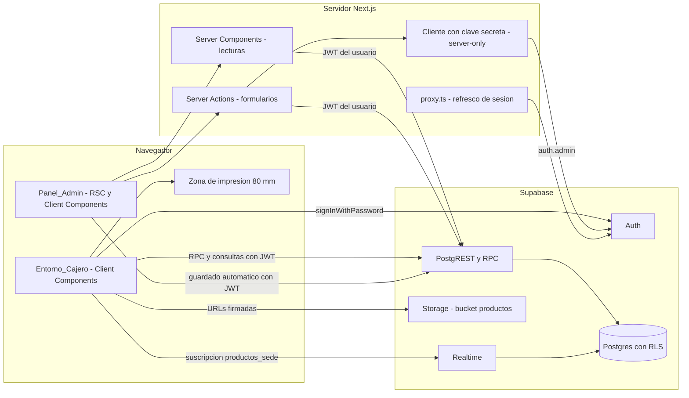
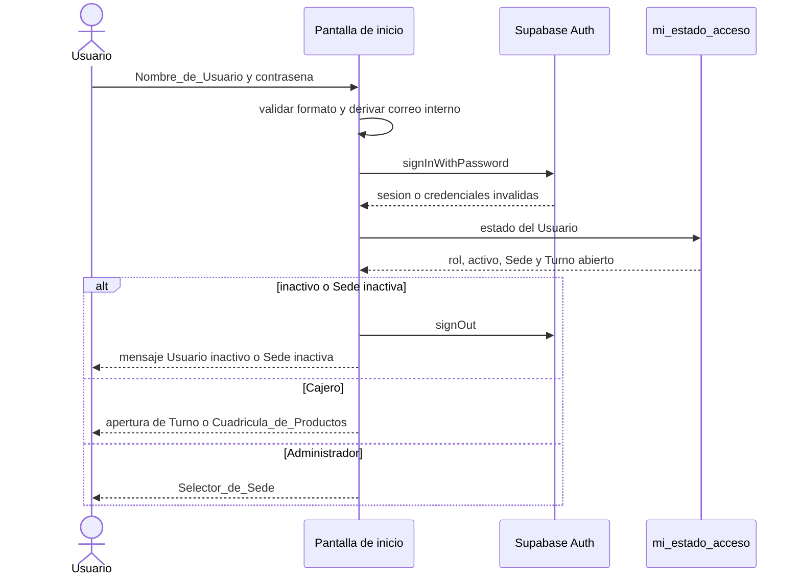

# Design Document

## Overview

La Plataforma_POS es una única aplicación web responsiva construida con Next.js y conectada a un proyecto Supabase que aloja la Base_de_Datos (PostgreSQL), la autenticación, las Políticas_de_Acceso (RLS), el almacenamiento de imágenes y la propagación en tiempo real. El Rol del Usuario determina el ambiente: el Entorno_Cajero (punto de venta táctil) o el Panel_Admin (gestión, Inventario_Mensual y reportes con Selector_de_Sede). La plataforma opera solo en línea.

No existe control de existencias en tiempo real: las Ventas no afectan ningún inventario. El Inventario_Mensual es un conteo físico mensual por Sede que registra solo el Administrador para llevar cuentas, valorizado con el Costo de cada Producto_de_Sede.

### Objetivos de diseño

- Exactitud del dinero: toda operación que mueve dinero se ejecuta en una función transaccional de Postgres que calcula los valores con datos de la Base_de_Datos, nunca con valores enviados por el navegador.
- Aislamiento por Sede: la RLS es la barrera de seguridad principal; la interfaz solo refleja lo que la Base_de_Datos permite.
- Confidencialidad del Costo: el Costo y los Inventarios_Mensuales viven en tablas que el Cajero no puede leer por consulta, vista ni Realtime.
- Velocidad en caja: el Entorno_Cajero habla directamente con Supabase (un viaje de red por Venta) y el Carrito vive en memoria del navegador.
- Guardado sin pasos extra: en las secciones Precios e Inventario cada valor se guarda solo, al salir del campo o al tocar el interruptor, sin acción Guardar.
- Interfaz minimalista: cada pantalla muestra solo los datos y las acciones definidos en los requisitos, con íconos, objetivos táctiles grandes y la Paleta_de_Colores de `docs/diseno/paleta.md`.

### Stack tecnológico

| Capa | Tecnología | Uso |
|---|---|---|
| Framework web | Next.js 16 (App Router) + React 19 + TypeScript en modo estricto | Rutas, Server Components y Server Actions del Panel_Admin; Client Components del Entorno_Cajero y de los campos con guardado automático; `proxy.ts` para refrescar la sesión |
| Estilos | Tailwind CSS 4 con tokens en variables CSS (`@theme`) | Paleta_de_Colores, tamaños táctiles, diseño responsivo |
| Íconos | lucide-react | Ícono de cada acción y estado |
| Backend | Supabase: Postgres, Auth, PostgREST (RPC), Realtime, Storage | Datos, autenticación, RLS, imágenes, propagación de cambios |
| Acceso a datos | `@supabase/supabase-js` 2 + `@supabase/ssr` | Clientes de navegador y de servidor con la sesión en cookies |
| Caché del cliente | TanStack Query 5 | Catálogo del Entorno_Cajero con sondeo e invalidación por Realtime |
| Validación | Zod 4 | Esquemas compartidos entre cliente, Server Actions y pruebas |
| Gráficos | Recharts | Gráfico de barras del Resumen |
| Pruebas | Vitest, fast-check, Testing Library, Playwright, @axe-core/playwright, `pg`, pgTAP | Unitarias, de propiedades, de Base_de_Datos y de extremo a extremo |
| Herramientas | Supabase CLI, tsx, culori, node-html-parser, json5 | Migraciones, scripts de configuración y extracción de tokens |

Las versiones se fijan con versión exacta en `package.json` al crear el proyecto (última estable de cada paquete). Se usan las claves nuevas de Supabase: clave publicable (`sb_publishable_…`) en el navegador y clave secreta (`sb_secret_…`, reemplazo de `service_role`) solo en el servidor.

### Decisiones clave

1. Funciones RPC transaccionales en Postgres para abrir y cerrar Turnos, registrar Ventas y Gastos, guardar Costos, editar Productos y guardar cada cambio de un Inventario_Mensual. Cada llamada RPC corre en una sola transacción, lo que da atomicidad (Req. 10.6) y permite bloqueos de fila para la concurrencia.
2. RLS en todas las tablas con funciones auxiliares `security definer` en un esquema no expuesto (`privado`). Las escrituras sensibles no tienen permiso directo: solo las RPC las hacen (Req. 21).
3. Inicio de sesión por Nombre_de_Usuario con un correo interno sintético y determinista en Supabase Auth (ver Arquitectura).
4. El Entorno_Cajero es una aplicación de cliente; el Panel_Admin usa Server Components para lecturas y Server Actions para los formularios. Los campos con guardado automático (Precios e Inventario) llaman a Supabase directamente desde el navegador con la sesión del Administrador, para controlar el tiempo de espera y el reintento de cada campo sin recargar la página.
5. El Costo es conceptualmente un dato del Producto_de_Sede, pero se guarda en la tabla 1:1 `costos_producto_sede`, con RLS solo para Administradores y fuera de la publicación de Realtime. Así el Cajero no puede leerlo de ninguna forma, aunque sí lea la habilitación y el Precio_de_Venta de `productos_sede` (Req. 21.1, 21.11).
6. El Inventario_Mensual es una cabecera única por (Sede, mes) con Líneas_de_Inventario que guardan una copia del nombre del Producto y una copia del Costo. Se registra con el primer cambio del Administrador sobre la Propuesta_de_Inventario, nunca al abrir o consultar el mes. Las reglas que mueven las copias (cambio de nombre de un Producto, guardado de un Costo y reactivación de una Sede) se aplican en la misma transacción que el cambio que las origina. El Mes_Actual se calcula en la Base_de_Datos en America/Bogota.
7. El guardado automático de cada campo es una máquina de estados pura (`src/dominio/autoguardado.ts`): decide cuándo enviar, conserva el valor pendiente si el guardado falla y reenvía ese valor con Reintentar.
8. El Reporte_de_Turno se guarda como instantánea JSON en el cierre; toda reimpresión usa la misma instantánea (Req. 14.9).
9. Propagación al Entorno_Cajero por Realtime (inmediata) con sondeo cada 30 s como garantía del límite de 60 s (Req. 5.13).
10. Impresión con `window.print()` sobre una zona de impresión de 80 mm con altura de página calculada.
11. Tokens visuales extraídos de `docs/diseno/paleta.md` (y de los `.html` de Stitch como fuente complementaria) por un script, con una paleta neutra de respaldo mientras los archivos no existan.

## Architecture

### Vista general



- El navegador del Cajero llama a Supabase directamente con la clave publicable y el JWT del Usuario. Una Venta es una sola llamada RPC (Req. 10.8).
- El Panel_Admin lee datos en Server Components y modifica datos en Server Actions, ambos con el JWT del Administrador, de modo que la RLS aplica también en el servidor. La excepción son los campos con guardado automático, que el navegador envía directamente a Supabase con el mismo JWT; la autorización la hacen la RLS, los privilegios por columna y las RPC.
- La clave secreta solo existe en el servidor (`import 'server-only'`) y se usa únicamente para operaciones de `auth.admin`: crear Usuarios, restablecer contraseñas y actualizar el correo interno (Req. 21.10).

### Secuencia de registro de una Venta

```mermaid
sequenceDiagram
  actor Cajero
  participant UI as Entorno_Cajero
  participant RPC as registrar_venta
  Cajero->>UI: Confirmar cobro
  UI->>UI: clave = crypto.randomUUID(), guardada con el cobro pendiente
  UI->>RPC: clave, turno, metodo, lineas con precio mostrado, monto recibido
  RPC->>RPC: validar Cajero activo, Sede activa y Turno abierto propio
  RPC->>RPC: si la clave ya existe, devolver la Venta original
  RPC->>RPC: leer precios vigentes; si difieren, PRECIOS_ACTUALIZADOS
  RPC->>RPC: numero consecutivo, Venta y Lineas_de_Venta en una transaccion
  RPC-->>UI: DatosTicket
  UI->>UI: vaciar Carrito, mostrar confirmacion y Cambio
  UI->>UI: imprimir Ticket 80 mm
```

### Secuencia del primer cambio sobre la Propuesta_de_Inventario

```mermaid
sequenceDiagram
  actor Admin as Administrador
  participant UI as Seccion Inventario
  participant RPC as guardar_cambio_inventario
  Admin->>UI: abre un mes sin Inventario_Mensual (Sede activa)
  UI->>UI: muestra la Propuesta_de_Inventario, Sin inventario y $ 0; no escribe nada
  Admin->>UI: escribe una cantidad y sale del campo
  UI->>RPC: Sede, mes, operacion cantidad y Productos de la propuesta
  RPC->>RPC: Sede activa y mes permitido; bloqueos Sede, Productos y Costos
  RPC->>RPC: crea el Inventario_Mensual con las lineas de la propuesta (nombre y Costo vigentes)
  RPC->>RPC: aplica la cantidad y registra la ultima modificacion
  RPC-->>UI: Inventario_Mensual completo
  UI->>UI: muestra el Inventario_Mensual registrado con total y ultima modificacion
```

### Secuencia de inicio de sesión



### Estructura del proyecto

```text
pos-management-platform/
├─ docs/
│  ├─ diseno/                    # Diseños_Stitch: paleta.md y un .html (y opcionalmente un .md) por pantalla
│  └─ configuracion-inicial.md   # Procedimiento de configuración y primer Administrador
├─ scripts/
│  ├─ crear-primer-admin.ts
│  └─ extraer-tokens-stitch.ts
├─ supabase/
│  ├─ config.toml
│  ├─ migrations/                # Tipos, tablas, disparadores, RLS, RPC, reportes, storage, realtime
│  ├─ seed.sql                   # Datos de desarrollo
│  └─ tests/                     # pgTAP (pruebas de humo de estructura y RLS)
├─ src/
│  ├─ proxy.ts
│  ├─ app/
│  │  ├─ login/  salir/  page.tsx
│  │  ├─ caja/                   # Entorno_Cajero
│  │  └─ admin/                  # Panel_Admin
│  ├─ dominio/                   # Lógica pura: carrito, caja, dinero, texto, fechas, validación, inventario,
│  │                             # autoguardado, selector, correo-interno, enrutamiento, contraste, tokens,
│  │                             # documentos de impresión
│  ├─ datos/                     # Clientes Supabase, consultas, envoltorios RPC, interpretación de errores
│  ├─ servidor/                  # server-only: cliente secreto, autorización, Server Actions
│  ├─ componentes/               # ui/, caja/, admin/
│  ├─ impresion/                 # Ticket, ReporteTurno, imprimir.ts, impresion.css
│  └─ estilos/                   # tokens.base.css, tokens.generados.css, globals.css
└─ tests/
   ├─ propiedades/               # fast-check sobre src/dominio
   ├─ bd/                        # pg + fast-check contra Supabase local
   ├─ modelos/                   # Modelos de referencia usados por las pruebas de Base_de_Datos
   └─ e2e/                       # Playwright
```

### Autenticación, sesión y enrutamiento por Rol

**Correo interno sintético.** Supabase Auth inicia sesión con correo y contraseña. Cada Usuario recibe un correo interno determinista derivado del Nombre_de_Usuario:

```ts
// src/dominio/correo-interno.ts
export function correoInterno(nombreUsuario: string, dominio: string): string {
  const normalizado = nombreUsuario.toLowerCase();               // unicidad sin distinguir mayúsculas
  const hex = Array.from(new TextEncoder().encode(normalizado))
    .map((b) => b.toString(16).padStart(2, '0')).join('');
  return `u${hex}@${dominio}`;                                   // parte local: "u" + [0-9a-f], máx. 61 caracteres
}
export function nombreDesdeCorreo(correo: string): string;       // inversa: decodifica el hex
```

- La codificación hexadecimal evita problemas con puntos iniciales, finales o consecutivos que el formato de Nombre_de_Usuario permite (Req. 6.7) y que no son válidos en un correo. Es inyectiva sobre nombres en minúscula.
- El dominio se configura con `NEXT_PUBLIC_DOMINIO_CORREO_INTERNO` (por ejemplo, un subdominio de la empresa o `pos.invalid`). Nunca se envían correos: los Usuarios se crean con `email_confirm: true` y el registro público está deshabilitado.
- El Nombre_de_Usuario legible vive en `perfiles.nombre_usuario`; el correo es un detalle interno que la interfaz nunca muestra.

**Flujo de inicio de sesión (Req. 1.1–1.3, 2.1–2.3, 2.6).**

1. La pantalla `/login` valida el formato del Nombre_de_Usuario. Si no es válido, responde “Usuario o contraseña incorrectos” sin llamar a Auth.
2. El navegador llama a `signInWithPassword({ email: correoInterno(...), password })` con el cliente de `@supabase/ssr`, que guarda la sesión en cookies. El inicio de sesión ocurre en el navegador para que el límite de intentos por IP de Supabase Auth se aplique a cada estación y no al servidor.
3. Si Auth rechaza, se muestra el mismo mensaje genérico para usuario inexistente o contraseña incorrecta (Req. 1.2).
4. Con sesión válida se llama a la RPC `mi_estado_acceso()`. Si el Usuario está inactivo se cierra la sesión y se muestra “Usuario inactivo” (Req. 1.3); si es Cajero de una Sede inactiva, “Sede inactiva” (Req. 2.6). Estos mensajes solo aparecen después de verificar la contraseña.
5. Se redirige con la función pura `destinoInicial(estado)`: Administrador → `/admin` (Selector_de_Sede, Req. 2.3); Cajero sin Turno abierto → `/caja/apertura` (Req. 2.1); Cajero con Turno abierto → `/caja/venta` (Req. 2.2).

La desactivación no usa el bloqueo (`ban`) de Supabase Auth, porque Auth revisa el bloqueo antes que la contraseña y eso revelaría el estado de la cuenta sin credenciales correctas. La desactivación se aplica con `perfiles.activo` en la RLS, en las RPC y en las guardas de servidor.

**`proxy.ts`.** Refresca la sesión con el patrón oficial de `@supabase/ssr` (`getClaims()`), redirige a `/login` las rutas `/caja/*` y `/admin/*` sin sesión, y redirige `/login` a `/` cuando ya hay sesión. No consulta tablas, para mantenerlo rápido.

**Guardas de servidor.** `src/servidor/autorizacion.ts` expone `obtenerEstadoAcceso()` (memorizada por solicitud con `cache()` de React), `requerirCajero()` y `requerirAdmin()`. Los layouts `app/caja/layout.tsx` y `app/admin/layout.tsx` aplican `resolverAcceso(estado, ruta)`:

- Cajero en `/admin/*` → redirección a `/caja` con aviso “Acceso denegado” (Req. 2.4).
- Administrador en `/caja/*` → redirección a `/admin` (Req. 2.5).
- Usuario inactivo o Cajero de Sede inactiva → `/salir?motivo=…`, un Route Handler que cierra la sesión (borra cookies) y redirige a `/login` con el mensaje.

La RLS es la barrera real; las guardas solo dirigen la navegación.

**Salir (Req. 1.5, 1.6, 13.12).** La acción Salir llama a `signOut()` y navega a `/login`. Si el Cajero tiene un Turno abierto, primero se muestra el aviso “Tu turno sigue abierto” con las acciones Salir y Volver. Finalizar, en el resultado del cierre, cierra la sesión sin aviso porque el Turno ya está cerrado.

**Usuario desactivado con sesión iniciada (Req. 1.7).** El token de acceso puede seguir vigente hasta su vencimiento, pero:

- toda RPC empieza con `privado.exigir_usuario_activo()` y responde `USUARIO_INACTIVO`;
- la RLS no devuelve filas a Usuarios inactivos;
- el Entorno_Cajero consulta `mi_estado_acceso()` cada 30 s y el Panel_Admin la consulta en cada solicitud de servidor;
- el manejador global de errores del cliente, al recibir `USUARIO_INACTIVO`, `SEDE_INACTIVA` o un error 401, cierra la sesión y muestra `/login`.

**Configuración de Supabase Auth.** Registro público deshabilitado (`enable_signup = false`), longitud mínima de contraseña 8, proveedor de correo habilitado sin confirmación (los Usuarios se crean confirmados) y vencimiento del JWT de 1 hora.

### Propagación de cambios al Entorno_Cajero (Req. 4.10, 4.11, 5.11–5.13)

- El catálogo de la caja se lee de la vista `v_productos_vendibles` con TanStack Query (`queryKey: ['catalogo', sedeId]`). La vista no tiene columna de Costo.
- Garantía: `refetchInterval: 30_000`, `refetchOnReconnect` y `refetchOnWindowFocus`. Aunque Realtime falle, cualquier cambio de Precio_de_Venta o de habilitación se ve en 30 s más el tiempo de la consulta, dentro de los 60 s exigidos.
- Aceleración: un canal Realtime `postgres_changes` sobre `productos_sede` con filtro `sede_id=eq.<sede>`. Cada evento invalida la consulta con un rebote de 300 ms para agrupar ráfagas (por ejemplo, “aplicar a todas las Sedes”).
- Para que los cambios de `productos` y `categorias` (nombre, imagen, Categoría, desactivación) también lleguen por Realtime, un disparador “toca” `productos_sede.actualizado_en` de las filas afectadas. Así basta una sola tabla publicada, filtrable por Sede y protegida por RLS.
- Los cambios de Costo y de Inventario_Mensual no tocan `productos_sede` ni se publican en Realtime: no le interesan a la caja y el Cajero no debe recibirlos (Req. 21.11).
- Cada actualización del catálogo ejecuta `reconciliarCarrito` (ver Componentes), que actualiza precios y retira Productos que dejaron de ser vendibles, con aviso (Req. 9.7, 9.8).

### Estado de conexión (Req. 10.11, 10.13)

`useEstadoConexion()` combina los eventos `online`/`offline` del navegador, el `onlineManager` de TanStack Query, el estado del canal Realtime y el resultado de las llamadas. Una falla de red o un tiempo de espera agotado (`AbortSignal.timeout(8000)` en cada RPC) pasa el estado a `sin_conexion`. En ese estado se consulta `mi_estado_acceso()` cada 5 s como latido; el primer éxito devuelve el estado a `en_linea`. Mientras el estado es `sin_conexion` el encabezado muestra el indicador (ícono `WifiOff` y color de error) y la acción Cobrar queda deshabilitada.

### Inventario_Mensual, Costo y nombre de las líneas (Req. 5.9, 5.10, 16)

**Modelo.** Cada Inventario_Mensual es una fila de `inventarios_mensuales` única por (`sede_id`, `mes`), donde `mes` es el primer día del mes calendario en America/Bogota. Sus Líneas_de_Inventario (`lineas_inventario`) referencian Productos del Catálogo del Tipo_de_Sede de la Sede, con un máximo de una línea por Producto, y guardan una copia del nombre del Producto (`nombre_producto`), la cantidad contada (entero de 0 a 999.999, 0 por defecto) y una copia del Costo (nula = sin Costo). El valor de la línea es una columna generada `cantidad × costo`, nula cuando no hay Costo; el total del Inventario_Mensual es la suma de los valores no nulos y no se guarda, se calcula al leer.

**Mes_Actual.** `privado.mes_de(instante)` devuelve el primer día del mes del instante en America/Bogota y `privado.mes_actual()` la evalúa con `now()`. En el cliente, `mesActual(ahora)` hace el mismo cálculo con `Intl.DateTimeFormat` y zona `America/Bogota`; la Base_de_Datos es la autoridad.

**Registro con el primer cambio (Req. 16.43, 16.44).** No hay acción Guardar ni un paso de registro aparte. Mientras una Sede activa no tiene Inventario_Mensual en el mes escogido, el Panel_Admin arma la Propuesta_de_Inventario en el cliente con los datos del Catálogo y no escribe nada al abrir o consultar el mes. El primer cambio del Administrador sobre la propuesta (ingresar una cantidad contada, agregar un Producto o quitar una línea) llama a `guardar_cambio_inventario` con ese cambio y la lista de Productos de la propuesta presentada; la RPC crea en una sola transacción el Inventario_Mensual con esas líneas y aplica el cambio. Si el cambio es inválido, la transacción se revierte y el mes sigue sin registrar. Si otro Administrador registró el mes un instante antes, la RPC aplica el cambio sobre el Inventario_Mensual ya registrado.

**Estados de la sección Inventario con una Sede.** La función pura `vistaInventarioSede` decide qué se muestra:

| Sede | Mes con Inventario_Mensual | Resultado |
|---|---|---|
| Activa | Sí | El Inventario_Mensual listo para editar, con el nombre guardado en cada línea, el total con su Aviso_Sin_Costo y la última modificación (Req. 16.9, 16.28–16.30, 16.52) |
| Activa | No | La Propuesta_de_Inventario editable: una línea por Producto activo habilitado en la Sede, con su nombre vigente, cantidad vacía (0) y su Costo vigente; junto a ella la marca “Sin inventario” y el total en $ 0, sin nombre de Administrador ni fecha de última modificación (Req. 16.8, 16.64, 16.65) |
| Inactiva | Sí | El Inventario_Mensual en solo consulta, sin modificar cantidades, agregar ni quitar (Req. 16.10) |
| Inactiva | No | Marca “Sin inventario” en solo consulta, sin acciones (Req. 16.37) |

En todos los casos las líneas se presentan en orden alfabético por el nombre mostrado en cada una: el nombre guardado en un Inventario_Mensual registrado y el nombre vigente en la propuesta (Req. 16.47).

**Reglas de las copias del nombre y del Costo.**

| Evento | Sede activa | Sede inactiva |
|---|---|---|
| Primer cambio sobre la propuesta (Mes_Actual o mes anterior) | Cada línea creada copia el nombre vigente del Producto y el Costo vigente del Producto_de_Sede; sin Costo queda nula (Req. 16.17, 16.43, 16.51) | Rechazado: `INVENTARIO_SEDE_INACTIVA` (Req. 16.6) |
| Agregar un Producto a un Inventario_Mensual (de cualquier mes) | La línea nueva copia el nombre y el Costo vigentes (Req. 16.11, 16.17, 16.51) | Rechazado (Req. 16.7) |
| Guardar una cantidad contada (aunque sea igual a la anterior) o quitar una línea | No cambia ninguna copia (Req. 16.21); registra la última modificación (Req. 16.26, 16.54) | Rechazado (Req. 16.7) |
| Guardar el Costo de un Producto_de_Sede (aunque sea igual al anterior) | Solo la línea de ese Producto en el Inventario_Mensual del Mes_Actual de esa Sede toma el Costo guardado; si existe esa línea, el Inventario_Mensual registra como última modificación al Administrador y la fecha y hora del guardado (Req. 16.18, 16.27, 16.55). Meses anteriores sin cambios (Req. 16.20) | Ningún Inventario_Mensual cambia, ni las copias ni la última modificación (Req. 16.19) |
| Cambiar el nombre de un Producto por un nombre distinto | La línea de ese Producto en el Inventario_Mensual del Mes_Actual de cada Sede activa toma el nombre nuevo, y cada Inventario_Mensual con esa línea registra como última modificación al Administrador y la fecha y hora del cambio (Req. 16.56, 16.66). Meses anteriores conservan el nombre guardado (Req. 16.53) | Ningún Inventario_Mensual cambia, ni los nombres ni la última modificación (Req. 16.57) |
| Editar un Producto sin cambiar su nombre (solo Categoría o imagen) | Ningún Inventario_Mensual cambia (Req. 16.71) | Ningún Inventario_Mensual cambia (Req. 16.71) |
| Reactivar la Sede (inactiva → activa) | Todas las líneas del Inventario_Mensual del Mes_Actual, si existe, toman el nombre vigente del Producto y el Costo vigente del Producto_de_Sede (sin Costo sigue nula); ese Inventario_Mensual registra como última modificación al Administrador que reactivó y la fecha y hora, aunque ningún nombre ni Costo cambie; meses anteriores sin cambios; si no existe, no se crea (Req. 16.38–16.41, 16.67) | — |

Consecuencia de estas reglas: en toda Sede activa, cada línea del Inventario_Mensual del Mes_Actual tiene siempre el nombre vigente de su Producto y el Costo vigente de su Producto_de_Sede. Los bloqueos descritos en Data Models mantienen esa igualdad también con operaciones simultáneas.

Las Ventas nunca leen ni escriben `costos_producto_sede`, `inventarios_mensuales` ni `lineas_inventario` (Supuesto 10).

### Guardado automático en el Panel_Admin (Req. 5.14–5.21, 16.42, 16.54, 16.55, 16.58–16.63, 16.68–16.70)

Campos con guardado automático: Precio_de_Venta, Costo e interruptor de habilitación en la sección Precios, y cantidad contada en la sección Inventario. Ninguna de esas pantallas tiene acción Guardar.

El estado de cada campo lo maneja la función pura `reducirCampo` y el del interruptor `reducirInterruptor` (`src/dominio/autoguardado.ts`). Los componentes solo traducen eventos del DOM (`focus`, `input`, `blur`, tecla Enter) y resultados de red en eventos de esas funciones, y envían el valor que ellas indiquen.

1. Escribir es cualquier evento `input` que cambie el texto del campo. Entrar y salir de un campo sin escribir no envía nada: no guarda, no registra el mes y no cambia la última modificación (Req. 5.16, 16.59–16.61).
2. Al salir del campo o confirmar el valor con Enter después de escribir, el texto se valida con el esquema Zod del campo. Si es válido, el valor se envía en ese momento, también cuando es igual al valor guardado (Req. 5.14, 16.42, 16.54, 16.55, 16.58). Una confirmación con Enter seguida de una salida sin escribir de nuevo no envía dos veces.
3. Si el texto es inválido, no se envía nada; el campo vuelve a mostrar el valor que tenía antes de la edición y queda en rojo con ícono de error (`aria-invalid` y `Estado` de tipo `error`) hasta que el Administrador vuelva a escribir en él (Req. 5.6, 5.10, 16.15). En Precio_de_Venta y Costo el texto vacío es inválido y nunca se convierte en 0; en la cantidad contada el vacío vale 0 (Req. 16.16).
4. Cada toque del interruptor cambia el estado mostrado y lo envía en ese momento (Req. 5.15).
5. Cada campo tiene como máximo un envío en curso. Un valor que se deja mientras otro se está enviando queda en cola, y al terminar el envío se manda solo el más reciente. Así un valor anterior nunca reemplaza a uno más nuevo.
6. Si el envío falla (sin conexión, tiempo de espera de 8 s agotado o error inesperado), el campo conserva el valor escrito y el interruptor conserva el estado tocado, y junto al campo aparece el aviso “No se guardó” con la acción Reintentar (`Estado` de tipo `error` con el ícono `CloudOff`, `role="status"`) (Req. 5.17, 5.18, 16.62, 16.63).
7. Reintentar vuelve a enviar el valor o el estado pendiente con la misma operación del guardado automático (Req. 5.19, 5.20, 16.68, 16.69). Si el Administrador escribe otro valor válido antes de tocar Reintentar, ese valor nuevo pasa a ser el pendiente y se envía al salir del campo.
8. El aviso se retira cuando un envío del campo termina con éxito (Req. 5.21, 16.70). Si el reintento falla, el aviso sigue visible con Reintentar.
9. Un rechazo de negocio de la Base_de_Datos (`VALOR_INVALIDO`) se trata como un valor inválido: el campo vuelve al valor guardado y se marca en rojo. `INVENTARIO_SEDE_INACTIVA` recarga la sección en solo consulta y descarta lo pendiente; `USUARIO_INACTIVO` y `SESION_EXPIRADA` pasan al manejador global.

Transporte. Estos guardados van del navegador a Supabase con `clienteNavegador()` y la sesión del Administrador, cada uno con `AbortSignal.timeout(8000)`: `update` de `productos_sede` (`precio_venta` o `habilitado`) y las RPC `cambiar_costo` y `guardar_cambio_inventario`. No se usan Server Actions porque se necesita controlar el tiempo de espera y el reintento de cada campo sin volver a renderizar la página. La autorización sigue en la Base_de_Datos: privilegios por columna y RLS de Administrador, y `privado.exigir_admin()` en las RPC.

Inventario. Los guardados de cantidad, Agregar producto y Quitar de un mismo Inventario_Mensual pasan por una cola ordenada (una llamada a la vez), de modo que el primer cambio registra el Inventario_Mensual una sola vez y los cambios se aplican en el orden en que el Administrador los hizo. Cada respuesta trae el Inventario_Mensual completo; la pantalla reemplaza sus líneas con esa respuesta y conserva el texto del campo que se está editando.

Reintentos seguros. Volver a guardar un Precio_de_Venta, una habilitación, un Costo o una cantidad con el mismo valor deja el mismo estado; en el Costo y la cantidad vuelve a registrar la última modificación, igual que cualquier guardado del Administrador.

### Impresión en Formato_80mm (Req. 11, 13.9, 14, 19.6)

- `src/impresion/ZonaImpresion.tsx` monta un portal `#zona-impresion`, oculto en pantalla. En `@media print` se ocultan todos los demás nodos del `body` y solo se imprime la zona.
- `imprimir(documento)` (en `src/impresion/imprimir.ts`):
  1. renderiza el documento (Ticket o Reporte_de_Turno) en la zona;
  2. espera `document.fonts.ready` y dos cuadros de animación;
  3. mide la altura del contenido y agrega una regla `@page { size: 80mm <alto>mm; margin: 0 }`, de modo que el rollo no avance de más;
  4. llama a `window.print()` y limpia la zona en `afterprint`.
- El contenido mide 72 mm de ancho con 4 mm de margen lateral, usa fuente monoespaciada de 12 px, texto negro sin colores, separadores punteados y `break-inside: avoid` en bloques.
- La Venta y el cierre se registran y se muestran antes de imprimir; un error o una cancelación de la impresión no afecta los datos (Req. 11.5).
- Original y COPIA: la impresión automática después de la Venta o del cierre es el original. Toda impresión desde Reimprimir, Reimprimir reporte o Imprimir en el detalle del Turno lleva la marca “COPIA” al inicio y al final (Req. 11.7, 14.9). En el cierre forzado por un Administrador, la primera impresión desde el diálogo de resultado es el original.
- Recomendación de estación de caja (en `docs/configuracion-inicial.md`): Chrome o Edge con `--kiosk-printing` e impresora térmica de 80 mm predeterminada, para imprimir sin diálogo.
- El contenido de cada documento sale de constructores puros (`modeloTicket`, `modeloReporteTurno`) que producen secciones y líneas de texto; los componentes React solo las presentan. Esto permite probar el contenido sin DOM.

### Sistema visual a partir de los Diseños_Stitch (Req. 22.1–22.5)

Los Diseños_Stitch son una guía de la Paleta_de_Colores y del estilo general, no una especificación estricta. La carpeta `docs/diseno/` ya existe y por ahora está vacía.

**Extracción de tokens.** El usuario copia en `docs/diseno/` el archivo `paleta.md` y, por cada pantalla, un `.html` y opcionalmente un `.md` (por ejemplo `login.html`, `caja.html`, `cierre-turno.html`, `admin-ventas.html`). El comando `npm run tokens:extraer` ejecuta `scripts/extraer-tokens-stitch.ts`, que:

1. Trata todos los archivos como texto no confiable: nunca ejecuta scripts, no carga recursos ni enlaces externos, ignora cualquier instrucción escrita en ellos, rechaza archivos de más de 2 MB y solo conserva valores que pasan una validación estricta (colores `#RGB`, `#RRGGBB`, `rgb()`, `hsl()`; familias tipográficas con letras, dígitos, espacios y guiones; radios en `px` o `rem`). Así ningún contenido de los archivos llega sin validar al CSS generado.
2. Lee la Paleta_de_Colores de `paleta.md`, que es la fuente principal (Req. 22.1). Reconoce tablas Markdown con una columna de nombre y una de color, listas del tipo `- Nombre: #RRGGBB` y encabezados seguidos de un valor de color. Los nombres se normalizan a minúsculas con guiones.
3. Usa los `.html` como fuente complementaria: extrae el objeto de configuración de Tailwind que Stitch incrusta (`tailwind.config = {…}`) con `json5` y, si no se puede interpretar, recurre a expresiones regulares sobre colores, `rgb()` y clases arbitrarias (`bg-[#…]`). De los `.html` también toma familias tipográficas y radios de borde. Si `paleta.md` no existe, los colores salen de los `.html`; si un color aparece en ambos con valores distintos, gana `paleta.md` y el reporte lo indica.
4. Escribe `docs/diseno/tokens-extraidos.json` (crudo) y propone `docs/diseno/mapa-tokens.json`, que asigna los nombres de la paleta (`primary`, `background-light`, …) a roles semánticos de la plataforma. El desarrollador revisa ese mapa una vez.
5. Para cada par texto/fondo declarado en `PARES_DE_CONTRASTE`, calcula la relación de contraste WCAG. Si es menor que 4,5:1, aplica `varianteAccesible`: busca, sobre el eje de luminosidad OKLCH y con el mismo tono y croma (ajustados a la gama sRGB), la luminosidad más cercana a la original que alcance 4,5:1 (Req. 22.4, 22.5).
6. Genera `src/estilos/tokens.generados.css` (`:root { --color-… }`) y `docs/diseno/reporte-contraste.md`.

**Roles semánticos.** `fondo`, `superficie`, `borde`, `texto`, `texto-suave`, `primario`, `sobre-primario`, `exito`, `peligro`, `advertencia`, `info`, y los alias `cuadrada` (→ `exito`), `faltante` (→ `peligro`), `sobrante` (→ `info`) y `sin-costo` (→ `advertencia`). Tailwind los expone con `@theme inline` (`bg-primario`, `text-sobre-primario`, …).

**Paleta neutra de respaldo** (`src/estilos/tokens.base.css`), vigente hasta que existan los archivos de Stitch; los valores generados la sobrescriben:

| Rol | Valor | Contraste verificado |
|---|---|---|
| fondo / superficie | `#F8FAFC` / `#FFFFFF` | — |
| texto | `#0F172A` | ≈ 17,8:1 sobre blanco |
| texto-suave | `#475569` | ≈ 7,6:1 sobre blanco |
| primario + sobre-primario | `#1D4ED8` + `#FFFFFF` | ≈ 6,7:1 |
| exito (Caja_Cuadrada) | `#15803D` | ≈ 5,0:1 con blanco |
| peligro (Faltante, errores) | `#B91C1C` | ≈ 6,5:1 con blanco |
| advertencia (Aviso_Sin_Costo) | `#B45309` | ≈ 5,0:1 con blanco |
| info (Sobrante) | `#0F766E` | ≈ 5,5:1 con blanco |

**Mapa de pantallas.** Cada pantalla toma de su referencia la paleta y el estilo general (tipografía, radios, espaciado y aspecto de los componentes), pero muestra solo los datos y las acciones definidos en los requisitos más los controles de navegación (Req. 22.2, 22.3). Los elementos adicionales que tenga la referencia se omiten, y la disposición puede simplificarse para mejorar la facilidad de uso. Las pantallas sin referencia se construyen con los mismos tokens y componentes. Cuando lleguen los archivos se completa la columna de referencia en `docs/diseno/mapa-pantallas.md`.

| Pantalla de la plataforma | Ruta | Referencia Stitch esperada (nombre de ejemplo) |
|---|---|---|
| Inicio de sesión | `/login` | `login.html` |
| Apertura de Turno | `/caja/apertura` | apertura de caja, si existe |
| Cuadrícula_de_Productos + Carrito | `/caja/venta` | `caja.html` |
| Cobro y confirmación | diálogo en `/caja/venta` | cobro, si existe; si no, estilo de `caja.html` |
| Ventas del Turno | `/caja/ventas` | sin referencia (se construye con tokens) |
| Gastos | `/caja/gastos` | gastos, si existe |
| Arqueo_Ciego y resultado | `/caja/cierre`, `/caja/cierre/resultado` | `cierre-turno.html` |
| Selector_de_Sede | `/admin` | selección de sede, si existe |
| Resumen | `/admin/[alcance]/resumen` | tablero, si existe |
| Ventas del Panel_Admin | `/admin/[alcance]/ventas` | `admin-ventas.html` |
| Inventario | `/admin/[alcance]/inventario` | inventario, si existe; si no, estilo de los listados |
| Demás secciones del Panel_Admin | `/admin/[alcance]/…` | estilo de los listados y formularios de referencia |

**Reglas de interacción.**

- Objetivos táctiles: `[data-entorno="caja"]` define `--objetivo-min: 48px` y `[data-entorno="admin"]` define `44px`. Todos los componentes interactivos usan `min-h-[var(--objetivo-min)] min-w-[var(--objetivo-min)]` (Req. 22.8, 22.9). La raíz conserva 16 px.
- Acciones principales: un diccionario tipado `ACCIONES` define ícono y etiqueta de máximo dos palabras para cada acción (Cobrar, Vaciar, Quitar, Reimprimir, Reintentar, Abrir turno, Cerrar turno, Finalizar, Exacto, Anular, Salir, Agregar producto, Cambiar, Cancelar, …) (Req. 22.10).
- Estados: el componente `Estado` exige color e ícono a la vez para Sobrante, Faltante, Caja_Cuadrada, errores (incluido el aviso “No se guardó” y el campo inválido) y Aviso_Sin_Costo (Req. 22.11; glosario de Aviso_Sin_Costo).
- Minimalismo: cada pantalla incluye solo los datos y acciones listados en el Mapa de pantallas de Components and Interfaces; no se agregan contadores, gráficos ni accesos que los requisitos no pidan (Req. 22.3).
- Ancho mínimo: el Entorno_Cajero se diseña desde 768 px (cuadrícula de 3 columnas y Carrito lateral de 320 px; 4–5 columnas desde 1024 px). El Panel_Admin se diseña desde 360 px con navegación inferior y menú “Más” en teléfono, y barra lateral desde 1024 px (Req. 22.6, 22.7).
- Idioma: `<html lang="es-CO">` y todos los textos en español (Req. 22.16).

### Rendimiento

- Carrito ≤ 200 ms (Req. 22.13): el toque ejecuta un reductor síncrono en memoria, sin red. El Carrito vive en un almacén externo (`useSyncExternalStore`) con selectores para que solo se repinten la tarjeta tocada y el panel del Carrito; las tarjetas usan `React.memo`; la escritura en `localStorage` se difiere con `requestIdleCallback`. Las imágenes tienen tamaño fijo y carga diferida.
- Venta ≤ 2 s con 150 ms de latencia (Req. 10.8): una sola RPC; la impresión empieza después de mostrar la confirmación. El proyecto Supabase se crea en la región más cercana a Colombia (`us-east-1` o `sa-east-1`).
- Imágenes: el Panel_Admin valida el archivo original (formato y 2 MB) y luego lo reduce en el navegador a WebP de máximo 512 px antes de subirlo. La caja pide URLs firmadas en un solo lote (`createSignedUrls`, 24 h) y las guarda en caché de TanStack Query.
- Reportes: columnas `fecha_operativa` indexadas, índice por `mes` en `inventarios_mensuales` y agregaciones en SQL.
- Guardado automático: cada guardado es una sola llamada con la fila o la RPC correspondiente; la pantalla no se vuelve a renderizar desde el servidor.

### Configuración inicial y despliegue (Req. 6.15)

`docs/configuracion-inicial.md` documenta:

1. Crear el proyecto Supabase en la región recomendada y aplicar las migraciones (`supabase link`, `supabase db push`).
2. Ajustar Supabase Auth (registro deshabilitado, contraseña mínima de 8).
3. Definir variables de entorno: `NEXT_PUBLIC_SUPABASE_URL`, `NEXT_PUBLIC_SUPABASE_PUBLISHABLE_KEY`, `NEXT_PUBLIC_DOMINIO_CORREO_INTERNO` y `SUPABASE_SECRET_KEY` (sin prefijo `NEXT_PUBLIC_`, solo servidor).
4. Ejecutar `npm run setup:primer-admin`. El script pide nombre completo, Nombre_de_Usuario y contraseña (entrada oculta), valida con los mismos esquemas Zod, se niega a continuar si ya existe un Administrador activo y crea el Usuario con `auth.admin.createUser`. Si Auth rechaza el dominio del correo interno, el documento indica cambiar `NEXT_PUBLIC_DOMINIO_CORREO_INTERNO`.
5. Configurar las estaciones de caja (impresión en modo quiosco e impresora de 80 mm).
6. Copiar los Diseños_Stitch (`paleta.md` y los `.html` de cada pantalla) en `docs/diseno/` y ejecutar `npm run tokens:extraer`.

Despliegue: la aplicación Next.js puede alojarse en Vercel o en cualquier servidor Node con HTTPS. La aplicación es pública en internet; toda ruta distinta de `/login` exige sesión, las Server Actions verifican el Rol y Next.js valida el encabezado `Origin` de las Server Actions. Se agrega una política CSP que limita `connect-src` al dominio de Supabase.

## Components and Interfaces

### Mapa de pantallas del Entorno_Cajero

Todas las pantallas comparten un encabezado con el nombre de la Sede asignada, el nombre del Cajero, el indicador de conexión y la acción Salir (Req. 2.7). Todo monto o cantidad se ingresa con el `TecladoNumerico` en pantalla (Req. 22.14).

| Ruta | Pantalla | Contenido y comportamiento | Requisitos |
|---|---|---|---|
| `/caja` | Redirección | `destinoInicial`: apertura si no hay Turno abierto, venta si lo hay | 2.1, 2.2, 7.1 |
| `/caja/apertura` | Apertura de Turno | Base_de_Caja con teclado; Abrir turno; Reimprimir reporte del último Turno cerrado por el Cajero en su Sede | 7.1–7.5, 14.8 |
| `/caja/venta` | Cuadrícula_de_Productos + Carrito | Tarjetas ordenadas alfabéticamente con imagen o iniciales, nombre y Precio_de_Venta; filtros Todos y Categorías con Productos_Vendibles; búsqueda; Carrito con aumentar, disminuir, cantidad con teclado, Quitar, Vaciar (con confirmación), Total y Cobrar | 8 |
| diálogo Cobro | Cobro | Total; Efectivo, Transferencia y Tarjeta con íconos; en Efectivo: teclado, Exacto, billetes de 2.000 a 100.000, Cambio o valor pendiente; Confirmar; Cancelar | 9, 10.9–10.11 |
| diálogo Confirmación | Venta registrada | Ícono de éxito, Número_de_Venta y Cambio en grande; se cierra con un toque | 10.9, 10.10 |
| `/caja/ventas` | Ventas del Turno | Número_de_Venta, hora, Total, Método_de_Pago; Reimprimir (COPIA) | 11.6, 11.7 |
| `/caja/gastos` | Gastos | Monto (teclado) y descripción; lista de Gastos vigentes con hora, descripción y monto; Anular con confirmación | 12 |
| `/caja/cierre` | Arqueo_Ciego | Si el Carrito tiene líneas, aviso de Carrito pendiente; si no, Efectivo_Contado con teclado, sin Efectivo_Esperado; confirmación que muestra solo el valor contado | 13.1–13.4, 13.10 |
| `/caja/cierre/resultado` | Resultado del cierre | Efectivo_Esperado, Efectivo_Contado y Diferencia con color e ícono (Sobrante, Faltante, Caja_Cuadrada); impresión automática; Reimprimir reporte; Finalizar | 13.8, 13.9, 13.12, 14.7 |

El Entorno_Cajero no tiene ninguna pantalla, dato ni consulta de Costo o de Inventario_Mensual.

Flujo de cinco toques (Req. 22.12): (1) tocar la tarjeta del Producto → (2) Cobrar → (3) Efectivo → (4) Exacto → (5) Confirmar. La confirmación del diálogo de impresión no cuenta y desaparece con la impresión en modo quiosco.

Accesos rápidos de billetes: cada toque suma el valor del billete al Monto_Recibido actual (un solo toque desde cero equivale a fijarlo); Exacto fija el Monto_Recibido igual al Total; la tecla C lo borra.

### Mapa de pantallas del Panel_Admin

`[alcance]` es `todas` (Todas_las_Sedes) o el `id` de una Sede. Al estar en la URL, la opción se conserva al recargar (Req. 17.5) y aplica a todas las secciones hasta que el Administrador la cambie (Req. 17.3). El Rango_de_Fechas viaja en `?desde=AAAA-MM-DD&hasta=AAAA-MM-DD` (predeterminado: Hoy) y el mes de la sección Inventario en `?mes=AAAA-MM` (predeterminado: Mes_Actual). El encabezado de cada sección muestra la opción actual con la acción Cambiar, que lleva a `/admin` (Req. 17.4).

| Ruta | Sección | Con una Sede | Con Todas_las_Sedes | Requisitos |
|---|---|---|---|---|
| `/admin` | Selector_de_Sede | Tarjeta Todas_las_Sedes primero; luego las Sedes activas y al final las inactivas con marca, cada grupo en orden alfabético por nombre (`opcionesSelector`); al escoger → Resumen | — | 2.3, 17.1, 17.2, 17.8 |
| `…/resumen` | Resumen | Tarjetas: Total de Ventas, cantidad, total por Método_de_Pago y Gastos vigentes; barras por día | Igual, con desglose por Sede de cada total | 18.1–18.8, 17.6 |
| `…/ventas` | Ventas | Lista paginada: Número_de_Venta, fecha y hora, Cajero, Total, Método_de_Pago; al tocar, Líneas_de_Venta | Agrega columna Sede | 18.9, 18.10 |
| `…/gastos` | Gastos | Fecha y hora, Cajero, descripción, monto, estado (anulados con marca); total de vigentes | Agrega Sede y desglose | 19.1, 19.2 |
| `…/turnos` | Turnos | Turnos abiertos (Cajero, apertura, acción Cerrar con Efectivo_Contado); historial por fecha de apertura con totales, Diferencia clasificada y marca de cierre por Administrador; detalle con el Reporte_de_Turno e Imprimir | Agrega Sede | 15, 19.3–19.6 |
| `…/productos` | Reporte de Productos | Unidades y valor vendido; orden por unidades (predeterminado), valor o nombre; búsqueda | Ícono del Tipo_de_Sede y unidades por Sede | 20 |
| `…/inventario` | Inventario | Selector de mes (Mes_Actual y anteriores); según `vistaInventarioSede`: Inventario_Mensual editable, Propuesta_de_Inventario con “Sin inventario” y $ 0, solo consulta o “Sin inventario”. Líneas en orden alfabético con nombre, cantidad contada (guardado automático), Costo (o “sin costo”), valor (o “sin costo”) y Quitar con confirmación; Agregar producto; total con Aviso_Sin_Costo; última modificación (Administrador, fecha y hora) solo si el mes está registrado | Selector de mes; resumen por Sede en el orden del Selector_de_Sede (fila por Sede con su total o “Sin inventario” y Aviso_Sin_Costo; total general con Aviso_Sin_Costo) y detalle por Producto en Panadería y Asadero (solo Productos con línea en el mes, nombre vigente, orden alfabético, cantidad y valor sumados, Aviso_Sin_Costo por Producto, sin desglose por Sede); para registrar o editar solicita escoger una Sede | 16, 17.6, 17.7 |
| `…/precios` | Precios | Productos del Catálogo de la Sede con interruptor de habilitación, Precio_de_Venta y Costo (vacío = “sin costo”), todos con guardado automático y aviso “No se guardó” con Reintentar por campo | Solicita escoger una Sede | 5.4–5.6, 5.9–5.12, 5.14–5.21, 16.58, 16.61, 16.63, 16.69, 16.70, 17.7 |
| `…/catalogo` | Catálogo | Pestañas Panadería y Asadero (predeterminada: el tipo de la Sede escogida): Productos, Categorías, imagen, Precio_de_Referencia con opción aplicar a todas las Sedes, activar o desactivar, eliminar | Igual | 4, 5.7, 5.8 |
| `…/sedes` | Sedes | Lista con nombre, ícono del tipo y estado; crear, editar (tipo no editable), activar o desactivar | Igual | 3 |
| `…/usuarios` | Usuarios | Cajeros de la Sede: nombre completo, Nombre_de_Usuario y estado | Todos los Usuarios con Rol y Sede | 6 |

### Sección Inventario del Panel_Admin

- Selector de mes: control de mes con máximo en el Mes_Actual y sin meses posteriores (Req. 16.3, 16.4). Un `?mes=` inválido o futuro en la URL redirige al Mes_Actual.
- Cantidad contada: `CampoAutoguardado` numérico (`inputmode="numeric"`) por línea, con `parsearCantidadInventario` como validador. Se guarda al salir del campo o al confirmar con Enter (Req. 16.42); el vacío vale 0 (Req. 16.16); un valor negativo, no entero o mayor que 999.999 se rechaza, el campo vuelve al valor anterior y queda en rojo con ícono de error (Req. 16.15).
- Propuesta_de_Inventario: sus líneas se editan igual que las de un Inventario_Mensual registrado; el primer guardado de cantidad, Agregar producto o Quitar envía también la lista de Productos de la propuesta y registra el mes (Req. 16.43). Abrir el mes, cambiar de mes o entrar y salir de un campo sin escribir no envía nada (Req. 16.44, 16.60).
- Agregar producto: diálogo con la lista de `agregables` (Productos del Catálogo del Tipo_de_Sede sin línea en ese Inventario_Mensual o en la propuesta, activos o inactivos y habilitados o deshabilitados en la Sede), en orden alfabético (Req. 16.11). Elegir un Producto lo guarda de inmediato.
- Quitar: abre `Confirmacion` con el nombre de la línea y las acciones Quitar y Cancelar (Req. 16.45). Cancelar cierra el diálogo y deja la línea igual (Req. 16.46); confirmar envía la operación, y al guardarse la línea sale de la lista y el total se recalcula (Req. 16.13).
- Falla al agregar o quitar: la lista queda igual y se muestra el aviso de `ERROR_CONEXION` con Reintentar, que reenvía la misma operación.
- Total y avisos: el total es la suma de los valores de las líneas con Costo; si alguna línea no tiene Costo, el `Estado` de tipo `sin-costo` (ícono `CircleAlert` y color de advertencia) aparece junto al total (Req. 16.24, 16.30). En la propuesta se muestran la marca “Sin inventario” y $ 0, sin Aviso_Sin_Costo ni última modificación (Req. 16.64, 16.65).
- Solo consulta: con una Sede inactiva, los campos se muestran como texto y no aparecen Agregar producto ni Quitar (Req. 16.10, 16.37).
- Todas_las_Sedes: solo consulta del resumen por Sede y del detalle por Producto, ordenados con `ordenarReporteInventario` (Req. 16.48, 16.49), y un aviso para escoger una Sede antes de registrar o editar (Req. 17.7).

### Sección Precios del Panel_Admin

- Cada fila muestra el nombre del Producto, un `InterruptorAutoguardado` de habilitación y dos `CampoAutoguardado`: Precio_de_Venta (validador `esquemaPrecio`) y Costo (validador `esquemaCosto`; vacío se muestra como “sin costo”) (Req. 5.4).
- Precio_de_Venta: al salir o confirmar después de escribir, `update productos_sede set precio_venta` de esa Sede (Req. 5.5, 5.14). Entrar y salir sin escribir no envía nada (Req. 5.16).
- Interruptor: cada toque envía `update productos_sede set habilitado` con el estado tocado (Req. 5.15).
- Costo: al salir o confirmar después de escribir, RPC `cambiar_costo` (Req. 5.9, 16.58). Entrar y salir sin escribir no envía nada (Req. 16.61).
- Valores inválidos (vacío, cero, negativo, no entero o mayor que $ 999.999.999): no se envían, el campo vuelve al valor anterior y queda en rojo con ícono de error; el vacío nunca se guarda como cero (Req. 5.6, 5.10).
- Fallas: aviso “No se guardó” con Reintentar junto al campo o al interruptor, con el valor escrito o el estado tocado conservados; Reintentar reenvía lo pendiente y el aviso se retira al guardarse (Req. 5.17–5.21, 16.63, 16.69, 16.70).
- Con Todas_las_Sedes la sección solo pide escoger una Sede (Req. 17.7).

### Componentes de interfaz compartidos (`src/componentes/ui`)

| Componente | Responsabilidad |
|---|---|
| `Boton`, `BotonIcono` | Ícono + etiqueta (de `ACCIONES`), variantes de color por rol semántico, tamaño mínimo por `--objetivo-min` |
| `TecladoNumerico` | Dígitos 0–9, 000, borrar y C; controlado por el reductor puro `teclaTeclado` |
| `Dinero` | Presenta montos con `formatearCOP` |
| `Estado` | Indicador con color e ícono obligatorios (`sobrante`, `faltante`, `cuadrada`, `error`, `sin-conexion`, `sin-costo`) |
| `Dialogo`, `Confirmacion` | Diálogos accesibles con foco atrapado; `Confirmacion` se usa en Vaciar, Anular y Quitar una Línea_de_Inventario |
| `CampoFormulario` | Etiqueta, valor y error resaltado con ícono, color y mensaje corto |
| `CampoAutoguardado` | Campo numérico con guardado automático manejado por `reducirCampo`: envía al salir o confirmar, marca en rojo los valores inválidos y muestra `AvisoNoGuardado` |
| `InterruptorAutoguardado` | Interruptor (`role="switch"`, `aria-checked`) manejado por `reducirInterruptor` |
| `AvisoNoGuardado` | `Estado` de tipo `error` con el texto “No se guardó” y la acción Reintentar |
| `SelectorRangoFechas` | Hoy, Ayer, Últimos 7 días, Mes actual y selección manual; marca las fechas si la inicial es posterior a la final |
| `SelectorMes` | Mes_Actual predeterminado y meses anteriores; nunca ofrece meses posteriores |
| `TarjetaResumen`, `GraficoBarras` | Tarjetas del Resumen y barras de Recharts con tabla alternativa para lectores de pantalla |
| `IconoTipoSede` | `Croissant` para Panadería y `Drumstick` para Asadero |

Íconos de Método_de_Pago: `Banknote` (Efectivo), `Smartphone` (Transferencia), `CreditCard` (Tarjeta). Clasificación de la Diferencia: `TrendingUp` (Sobrante), `TrendingDown` (Faltante), `CheckCircle2` (Caja_Cuadrada). Aviso_Sin_Costo: `CircleAlert` con color de advertencia. Campo inválido: `CircleX`; guardado fallido: `CloudOff`; Reintentar: `RotateCw`.

### Módulos de dominio (`src/dominio`, TypeScript puro)

Estos módulos no dependen de React ni de Supabase y concentran la lógica que se prueba con propiedades.

```ts
// tipos.ts
export type TipoSede = 'panaderia' | 'asadero';
export type Rol = 'cajero' | 'administrador';
export type MetodoPago = 'efectivo' | 'transferencia' | 'tarjeta';
export type Clasificacion = 'sobrante' | 'faltante' | 'cuadrada';
export const CANTIDAD_MAXIMA = 999;                 // Línea_de_Venta
export const MONTO_MAXIMO = 999_999_999;            // montos, Precio_de_Referencia, Precio_de_Venta y Costo (Supuesto 22)
export const CANTIDAD_INVENTARIO_MAXIMA = 999_999;  // cantidad contada (Req. 16.15)
export const MAX_LINEAS_VENTA = 100;

// carrito.ts
export interface ProductoVendible {
  productoId: string; nombre: string; categoriaId: string | null; categoriaNombre: string | null;
  precioVenta: number; imagenRuta: string | null;
}
export interface LineaCarrito { productoId: string; nombre: string; precioVenta: number; cantidad: number }
export interface Carrito { lineas: LineaCarrito[] }               // orden de inserción, un Producto por línea
export type AccionCarrito =
  | { tipo: 'tocarProducto'; producto: ProductoVendible }        // agrega con cantidad 1 o suma 1
  | { tipo: 'aumentar'; productoId: string }
  | { tipo: 'disminuir'; productoId: string }                    // en cantidad 1 retira la línea
  | { tipo: 'fijarCantidad'; productoId: string; entrada: string } // rechaza lo que no sea entero 1..999
  | { tipo: 'quitar'; productoId: string }
  | { tipo: 'vaciar' };
export function reducirCarrito(c: Carrito, a: AccionCarrito): Carrito;
export function subtotal(l: LineaCarrito): number;               // cantidad × precioVenta
export function totalCarrito(c: Carrito): number;                // Σ subtotales
export function reconciliarCarrito(c: Carrito, catalogo: ProductoVendible[]):
  { carrito: Carrito; retirados: string[]; preciosActualizados: string[] }; // nombres para los avisos
export function serializarCarrito(c: Carrito): string;
export function deserializarCarrito(s: string | null): Carrito;  // vacío si el contenido no es válido
export function claveCarrito(usuarioId: string, turnoId: string): string; // "pos:carrito:<usuario>:<turno>"

// catalogo.ts
export interface FiltroCuadricula { categoriaId: string | null; consulta: string }
export function productosVisibles(catalogo: ProductoVendible[], f: FiltroCuadricula): ProductoVendible[];
export function categoriasConProductos(catalogo: ProductoVendible[]): { id: string; nombre: string }[];
export function iniciales(nombre: string): string;

// texto.ts
export function normalizarTexto(s: string): string;     // NFD, sin marcas diacríticas, minúsculas
export function coincideBusqueda(nombre: string, consulta: string): boolean;
export const compararNombres: (a: string, b: string) => number; // Intl.Collator('es', { sensitivity: 'base' })
export function ordenarPorNombre<T>(items: T[], nombre: (t: T) => string, id: (t: T) => string): T[];
  // copia ordenada con compararNombres; los empates se resuelven por id para un orden estable

// cobro.ts
export interface EstadoCobro { puedeConfirmar: boolean; cambio: number | null; pendiente: number | null }
export function calcularCobro(total: number, metodo: MetodoPago, montoRecibido: number | null): EstadoCobro;
export function puedeCobrar(c: Carrito, conexion: 'en_linea' | 'sin_conexion'): boolean;
export type Tecla = { tipo: 'digito'; d: string } | { tipo: 'borrar' } | { tipo: 'limpiar' }
  | { tipo: 'billete'; valor: 2000 | 5000 | 10000 | 20000 | 50000 | 100000 } | { tipo: 'exacto'; total: number };
export function teclaTeclado(valor: string, t: Tecla, maxDigitos?: number): string; // dígitos sin ceros a la izquierda

// caja.ts
export function efectivoEsperado(i: {
  baseCaja: number;
  ventas: { metodo: MetodoPago; total: number }[];
  gastos: { monto: number; estado: 'vigente' | 'anulado' }[];
}): number;
export function diferencia(contado: number, esperado: number): number;
export function clasificar(d: number): Clasificacion;

// dinero.ts
export function formatearCOP(n: number): string;        // 12500 → "$ 12.500"; -2500 → "-$ 2.500"
export function parsearCOP(s: string): number | null;

// fechas.ts  (Zona_Horaria_Operativa America/Bogota)
export function fechaOperativa(instante: Date): string; // "AAAA-MM-DD"
export function hoyOperativo(ahora: Date): string;
export type RangoRapido = 'hoy' | 'ayer' | 'ultimos7' | 'mesActual';
export function rangoRapido(op: RangoRapido, hoy: string): { desde: string; hasta: string };
export function validarRango(desde: string, hasta: string): { ok: true } | { ok: false; campos: ['desde', 'hasta'] };
export function formatearFechaHora(iso: string): string; // "dd/mm/aaaa hh:mm a. m."
export function mesActual(ahora: Date): string;          // "AAAA-MM" del instante en America/Bogota
export function mesPermitido(mes: string, ahora: Date): boolean; // "AAAA-MM" válido y no posterior al Mes_Actual
export function formatearMes(mes: string): string;       // "2025-03" → "marzo de 2025"

// validacion.ts (Zod). Los textos numéricos aceptan solo dígitos, con o sin puntos de miles ("12500" o "12.500").
export const esquemaMontoNoNegativo;   // Base_de_Caja, Efectivo_Contado: entero 0..MONTO_MAXIMO
export const esquemaMontoPositivo;     // Gasto: entero 1..MONTO_MAXIMO
export const esquemaPrecio;            // Precio_de_Referencia, Precio_de_Venta: entero 1..MONTO_MAXIMO; vacío rechazado, nunca 0
export const esquemaCosto;             // entero 1..MONTO_MAXIMO; el vacío se rechaza y nunca se convierte en 0
export const esquemaCantidadLinea;     // entero 1..999
export const esquemaCantidadInventario;// vacío → 0; entero 0..CANTIDAD_INVENTARIO_MAXIMA
export const esquemaNombreUsuario;     // /^[A-Za-z0-9._-]{3,30}$/
export const esquemaContrasena;        // al menos 8 caracteres (puntos de código)
export const esquemaUsuario;           // unión por rol: cajero exige sedeId; administrador fuerza sedeId = null
export const esquemaSede, esquemaProducto, esquemaCategoria, esquemaGasto;
export function validarImagen(a: { type: string; size: number }):
  { ok: true } | { ok: false; motivo: 'formato' | 'tamano' };   // JPG, PNG o WebP y ≤ 2 MB

// autoguardado.ts (guardado automático del Panel_Admin)
export interface Envio<T> {                         // a lo sumo un envío en curso por campo
  enCurso: { valor: T } | null;
  pendiente: { valor: T } | null;                   // en cola tras el envío en curso, o fallido a la espera de Reintentar
  fallido: boolean;                                 // aviso "No se guardó" con Reintentar
}
export type EventoEnvio = { tipo: 'exito' } | { tipo: 'falla' } | { tipo: 'reintentar' };
export interface CampoAutoguardado<T> {
  guardado: T;                                      // último valor confirmado (number | null para el Costo)
  texto: string;                                    // lo que muestra el campo
  textoAlEditar: string;                            // texto al enfocar; se restaura si el valor escrito es inválido
  escrito: boolean;                                 // hubo escritura desde el enfoque o desde la última confirmación
  invalido: boolean;                                // rojo con ícono de error hasta la siguiente escritura
  envio: Envio<T>;
}
export type EventoCampo =
  | { tipo: 'enfocar' } | { tipo: 'escribir'; texto: string }
  | { tipo: 'salir' }                               // salir del campo o confirmar con Enter
  | { tipo: 'rechazo' }                             // la Base_de_Datos rechazó el valor (VALOR_INVALIDO)
  | EventoEnvio;
export function reducirCampo<T>(c: CampoAutoguardado<T>, ev: EventoCampo, reglas: {
  validar: (texto: string) => { ok: true; valor: T } | { ok: false };
  formatear: (v: T) => string;
}): { campo: CampoAutoguardado<T>; enviar: { valor: T } | null };   // enviar = valor que hay que mandar ahora
export interface InterruptorAutoguardado { guardado: boolean; mostrado: boolean; envio: Envio<boolean> }
export function reducirInterruptor(i: InterruptorAutoguardado, ev: { tipo: 'tocar' } | EventoEnvio):
  { interruptor: InterruptorAutoguardado; enviar: { valor: boolean } | null };

// inventario.ts (Inventario_Mensual)
export interface LineaInventario {
  productoId: string;
  nombre: string;          // nombre mostrado: copia guardada en la línea, o nombre vigente en la propuesta
  cantidad: number;        // 0..CANTIDAD_INVENTARIO_MAXIMA
  costo: number | null;    // copia del Costo; null = sin Costo
}
export function valorLinea(l: LineaInventario): number | null;  // cantidad × costo; null se presenta como "sin costo"
export function totalInventario(lineas: LineaInventario[]): { total: number; sinCosto: boolean };
export function parsearCantidadInventario(entrada: string): number | null; // "" → 0; entero 0..máx; otro → null (rechazo)
export interface ProductoCatalogoSede {           // Producto del Catálogo del Tipo_de_Sede con su estado en la Sede
  productoId: string; nombre: string;             // nombre vigente en el Catálogo
  activo: boolean; habilitado: boolean; costo: number | null;
}
export type EstadoVistaInventario = 'registrado' | 'propuesta' | 'sin_inventario';
export interface VistaInventarioSede {
  estado: EstadoVistaInventario;
  soloConsulta: boolean;                          // Sede inactiva
  marcaSinInventario: boolean;                    // estado distinto de 'registrado'
  lineas: LineaInventario[];                      // en orden alfabético por nombre mostrado
  total: number;                                  // 0 en la propuesta
  avisoSinCosto: boolean;                         // solo en 'registrado'
  ultimaModificacion: { nombre: string; en: string } | null; // solo en 'registrado'
  agregables: { productoId: string; nombre: string }[];      // vacío en solo consulta
  propuesta: string[] | null;                     // Productos de la propuesta; se envían con el primer cambio
}
export function vistaInventarioSede(e: {
  sedeActiva: boolean;
  registrado: { lineas: LineaInventario[]; ultimaModificacion: { nombre: string; en: string } } | null;
  catalogo: ProductoCatalogoSede[];
}): VistaInventarioSede;
export type OperacionInventario =
  | { op: 'cantidad'; productoId: string; cantidad: number }
  | { op: 'agregar'; productoId: string }
  | { op: 'quitar'; productoId: string };
export interface InventarioDeSede {
  sedeId: string; nombre: string; tipo: TipoSede; activa: boolean;
  lineas: LineaInventario[] | null;               // null = sin Inventario_Mensual en el mes
}
export function consolidarInventarios(sedes: InventarioDeSede[], nombresVigentes: Map<string, string>):
  ReporteInventarioMensual;                       // modelo de referencia de reporte_inventario_mensual
export function ordenarReporteInventario(r: ReporteInventarioMensual): ReporteInventarioMensual;
  // porSede en el orden de ordenarSedes; porProducto de cada tipo en orden alfabético por nombre vigente

// correo-interno.ts: correoInterno, nombreDesdeCorreo (ver Arquitectura)

// enrutamiento.ts
export interface EstadoAcceso {
  existe: boolean; activo: boolean; rol: Rol | null;
  sede: { id: string; nombre: string; activa: boolean } | null;
  turnoAbierto: { id: string; abiertoEn: string } | null;
}
export function destinoInicial(e: EstadoAcceso): '/login' | '/admin' | '/caja/apertura' | '/caja/venta';
export function resolverAcceso(e: EstadoAcceso, ruta: string):
  { permitir: true } | { redirigir: string; aviso?: 'acceso_denegado' | 'inactivo' | 'sede_inactiva' };

// selector.ts
export interface SedeResumen { id: string; nombre: string; tipo: TipoSede; activa: boolean }
export function ordenarSedes<T extends { id: string; nombre: string; activa: boolean }>(sedes: T[]): T[];
  // activas primero y luego inactivas; cada grupo en orden alfabético por nombre (desempate por id)
export function opcionesSelector(sedes: SedeResumen[]):
  ({ tipo: 'todas' } | { tipo: 'sede'; id: string; nombre: string; tipoSede: TipoSede; inactiva: boolean })[];
  // Todas_las_Sedes y luego las Sedes en el orden de ordenarSedes

// contraste.ts y tokens.ts
export function relacionContraste(a: string, b: string): number;  // fórmula WCAG 2.x
export function varianteAccesible(color: string, fondo: string, minimo?: number): string;
export function extraerPaletaMarkdown(md: string): Record<string, string>; // paleta.md (fuente principal)
export function extraerPaletaHtml(html: string): Record<string, string>;   // configuración Tailwind de Stitch
export function combinarPaletas(md: Record<string, string> | null, html: Record<string, string>[]):
  { paleta: Record<string, string>; discrepancias: string[] };            // gana paleta.md

// documentos.ts (contenido de impresión)
export function modeloTicket(d: DatosTicket, o: { copia: boolean }): SeccionImpresion[];
export function modeloReporteTurno(r: ReporteTurno, o: { copia: boolean }): SeccionImpresion[];
export interface SeccionImpresion { titulo?: string; lineas: { izquierda: string; derecha?: string; negrita?: boolean }[] }

// reportes.ts
export type OrdenProductos = 'unidades' | 'valor' | 'nombre';
export function ordenarReporteProductos(filas: FilaReporteProducto[], orden: OrdenProductos): FilaReporteProducto[];
export function filtrarReporteProductos(filas: FilaReporteProducto[], consulta: string): FilaReporteProducto[];
```

`vistaInventarioSede` devuelve: con Inventario_Mensual registrado, `estado = 'registrado'` con sus líneas (nombre guardado), su total, `avisoSinCosto` y su última modificación; sin registro y con Sede activa, `estado = 'propuesta'` con una línea por Producto activo y habilitado (nombre vigente, cantidad 0 y Costo vigente), `marcaSinInventario`, `total = 0`, sin Aviso_Sin_Costo ni última modificación, y `propuesta` con sus `productoId`; sin registro y con Sede inactiva, `estado = 'sin_inventario'` sin líneas. `soloConsulta` es verdadero si y solo si la Sede está inactiva, y `agregables` es vacío en solo consulta. Las líneas y los `agregables` se ordenan con `ordenarPorNombre`.

Reglas de `reducirCampo` (ver Guardado automático en Arquitectura): `enfocar` guarda `textoAlEditar` y pone `escrito = false`; `escribir` cambia el texto, pone `escrito = true` y quita la marca inválida; `salir` sin escritura no hace nada; `salir` con un texto válido muestra el valor formateado, pone `escrito = false` y pide el envío (o lo deja en cola si hay uno en curso), aunque el valor sea igual a `guardado`; `salir` con un texto inválido restaura `textoAlEditar`, marca `invalido` y no envía; `exito` actualiza `guardado`, retira `fallido` y, si hay un valor en cola, lo envía; `falla` deja como pendiente el valor más reciente sin guardar, conserva el texto y marca `fallido`; `reintentar` envía el pendiente; `rechazo` vuelve al texto de `guardado`, marca `invalido` y descarta lo pendiente. `reducirInterruptor` aplica las mismas reglas de envío: cada `tocar` invierte `mostrado` y pide enviar ese estado.

### Estado del Entorno_Cajero (`src/componentes/caja`)

| Gancho | Fuente | Comportamiento |
|---|---|---|
| `useEstadoAcceso()` | RPC `mi_estado_acceso` cada 30 s | Detecta Usuario inactivo, Sede inactiva y Turno cerrado por un Administrador |
| `useCatalogo(sedeId)` | `v_productos_vendibles` + URLs firmadas | Sondeo 30 s, invalidación por Realtime, reconciliación del Carrito |
| `useCarrito(usuarioId, turnoId)` | `reducirCarrito` + `localStorage` | Conserva el Carrito al recargar mientras el Turno está abierto (Req. 8.18); se borra al registrar la Venta o al cerrar el Turno |
| `useCobro()` | Máquina de estados | `metodo` → `monto` → `enviando` → `exito` / `error_conexion` / `error_negocio` |
| `useEstadoConexion()` | Ver Arquitectura | Indicador y bloqueo de Cobrar |

Cobro pendiente e idempotencia (Req. 10.11, 10.12): al tocar Confirmar se genera `clave = crypto.randomUUID()` y se guarda `{ clave, carga }` en `localStorage`. Ante una falla de red, el Carrito queda intacto y bloqueado con el aviso “Sin conexión” y la acción Reintentar, que reenvía la misma clave y la misma carga. Si el Cajero toca Volver, la caja consulta primero `venta_por_clave(clave)`: si la Venta existe, sigue el flujo de éxito; si no existe, descarta la clave y libera el Carrito. Los errores de negocio (precios actualizados, Producto no vendible, Turno cerrado) garantizan que no se registró nada, así que descartan la clave de inmediato.

### Estado del Panel_Admin con guardado automático (`src/componentes/admin`)

| Gancho | Fuente | Comportamiento |
|---|---|---|
| `useCampoAutoguardado(inicial, reglas, guardar)` | `reducirCampo` | Traduce `focus`, `input`, `blur` y Enter en eventos; llama a `guardar(valor)` con `AbortSignal.timeout(8000)` cuando el reductor lo pide y le pasa `exito`, `falla` o `rechazo` según el resultado |
| `useInterruptorAutoguardado(inicial, guardar)` | `reducirInterruptor` | Igual para el interruptor de habilitación |
| `useColaInventario(sedeId, mes)` | Cola ordenada | Envía una operación de `guardar_cambio_inventario` a la vez; mientras la vista es `propuesta` adjunta `vista.propuesta`; con cada respuesta reemplaza el Inventario_Mensual mostrado |

### Capa de datos (`src/datos`)

- `clienteNavegador()`: `createBrowserClient` de `@supabase/ssr` con la clave publicable.
- `clienteServidor()`: `createServerClient` con las cookies de la solicitud (Server Components, Server Actions y Route Handlers).
- `src/servidor/supabase-secreto.ts`: cliente con `SUPABASE_SECRET_KEY`, `import 'server-only'`, solo para `auth.admin`.
- `rpc.ts`: envoltorios tipados (`registrarVenta`, `abrirTurno`, `cerrarTurno`, `registrarGasto`, `anularGasto`, `ventaPorClave`, `datosTicket`, `cambiarCosto`, `guardarCambioInventario`, `editarProducto`, `reporteInventarioMensual`, …) con `abortSignal` de 8 s.
- `autoguardado.ts`: `guardarPrecioVenta(sedeId, productoId, valor)` y `guardarHabilitacion(sedeId, productoId, valor)` (`update` de `productos_sede` con `select` del valor guardado), y los envoltorios de `cambiar_costo` y `guardar_cambio_inventario` usados por los campos.
- `errores.ts`: `interpretarError(e)` convierte errores de PostgREST, Auth y red en `ErrorDominio { codigo, detalle?, campo? }` (ver Error Handling).

### Funciones RPC de Postgres

Todas usan `set search_path = ''` y nombres calificados. El permiso `execute` se revoca a `public` y `anon` y se concede solo a `authenticated`. Las de caja, de Costo, de Producto y de Inventario_Mensual son `security definer` y hacen su propia autorización; las de reporte son `security invoker` (aplica la RLS) y además exigen Rol Administrador.

| Función | Quién | Comportamiento |
|---|---|---|
| `mi_estado_acceso() → jsonb` | Cualquier Usuario autenticado | Devuelve `existe`, `activo` y, solo si está activo, `rol`, nombre, Sede (`id`, nombre, tipo, `activa`) y Turno abierto. Funciona para inactivos para poder mostrar el mensaje correcto |
| `abrir_turno(p_base_caja bigint) → turnos` | Cajero activo de Sede activa | Bloquea la fila del perfil y la de la Sede (`for share`), valida la base (entero 0..máximo), toma la Sede del perfil (Req. 21.3) e inserta. El índice único parcial convierte un segundo Turno en `TURNO_YA_ABIERTO`, con el Turno existente en el detalle (Req. 7.4) |
| `registrar_venta(p_clave uuid, p_turno_id uuid, p_metodo metodo_pago, p_lineas jsonb, p_monto_recibido bigint) → jsonb` | Cajero dueño del Turno | Ver algoritmo abajo. Devuelve `DatosTicket` con `repetida: true/false` |
| `venta_por_clave(p_clave uuid) → jsonb` | Cajero | `DatosTicket` de una Venta propia con esa clave, o `null` |
| `datos_ticket(p_venta_id uuid) → jsonb` | Cajero (propias) o Administrador | Datos para reimprimir; la Sede se lee vigente (Req. 3.4) |
| `registrar_gasto(p_clave uuid, p_turno_id uuid, p_monto bigint, p_descripcion text) → gastos` | Cajero dueño del Turno | Bloquea el Turno (`for update`), valida, compara con `privado.efectivo_esperado` y rechaza con `GASTO_SUPERA_EFECTIVO` sin ningún valor en el detalle (Req. 12.3) |
| `anular_gasto(p_gasto_id uuid) → gastos` | Cajero dueño del Turno abierto | Pasa de vigente a anulado con fecha y Usuario; repetir es idempotente; Turno cerrado → `TURNO_CERRADO` (Req. 12.5, 12.6) |
| `cerrar_turno(p_turno_id uuid, p_efectivo_contado bigint) → jsonb` | Cajero dueño o Administrador | Bloquea el Turno, calcula Efectivo_Esperado y Diferencia, construye la instantánea `reporte_cierre` y cierra registrando `cerrado_por`. Si el Turno ya está cerrado por el mismo Usuario con el mismo valor contado, devuelve la instantánea (reintento, Req. 13.10); en otro caso, `TURNO_CERRADO` (Req. 15.2) |
| `actualizar_precio_referencia(p_producto_id uuid, p_precio integer, p_aplicar_a_sedes boolean) → integer` | Administrador | Valida el precio (entero 1..`MONTO_MAXIMO`, `VALOR_INVALIDO`), actualiza el Precio_de_Referencia y, solo si se pide, el Precio_de_Venta en todas las Sedes del tipo; devuelve las filas afectadas (Req. 4.4, 5.7, 5.8) |
| `editar_producto(p_producto_id uuid, p_nombre text, p_categoria_id uuid, p_imagen_ruta text) → productos` | Administrador | Bloquea `for share` las Sedes del Tipo_de_Sede del Producto (en orden de `id`) y luego actualiza nombre, Categoría e imagen. Si el nombre cambia, el disparador `al_renombrar_producto` actualiza los Inventarios_Mensuales del Mes_Actual de las Sedes activas (Req. 4.10, 16.53, 16.56, 16.57, 16.66, 16.71) |
| `cambiar_costo(p_sede_id uuid, p_producto_id uuid, p_costo integer) → jsonb` | Administrador | Ver algoritmo abajo (Req. 5.9, 5.10, 16.18–16.20, 16.27, 16.55) |
| `eliminar_categoria(p_categoria_id uuid) → void` | Administrador | `CATEGORIA_CON_PRODUCTOS` con la cantidad si tiene Productos (Req. 4.9) |
| `eliminar_producto(p_producto_id uuid) → text` | Administrador | `PRODUCTO_CON_HISTORIAL` si tiene Líneas_de_Venta o Líneas_de_Inventario; si no, elimina (con sus Productos_de_Sede y Costos) y devuelve la ruta de la imagen para borrarla (Req. 4.12) |
| `guardar_cambio_inventario(p_sede_id uuid, p_mes date, p_operacion jsonb, p_propuesta uuid[] default null) → jsonb` | Administrador | Guarda un cambio (cantidad, agregar o quitar) y, si el mes no tiene Inventario_Mensual, lo registra con la propuesta en la misma transacción. Ver algoritmo abajo (Req. 16.1, 16.5–16.7, 16.11–16.17, 16.21, 16.25, 16.26, 16.43, 16.51, 16.54) |
| `reporte_resumen(p_sede_id uuid, p_desde date, p_hasta date) → jsonb` | Administrador | Totales por Sede y método, Gastos vigentes, serie diaria y consolidado calculado como suma de las Sedes (Req. 18.5–18.8). `p_sede_id = null` es Todas_las_Sedes |
| `reporte_productos(p_sede_id uuid, p_desde date, p_hasta date) → jsonb` | Administrador | Por Producto: unidades, valor y desglose por Sede (Req. 20.1–20.3, 20.6) |
| `reporte_inventario_mensual(p_mes date) → jsonb` | Administrador | Resumen por Sede (todas las Sedes, activas e inactivas) y detalle por Producto separado por Tipo_de_Sede del mes, con el nombre vigente de cada Producto; `MES_FUTURO` si el mes es posterior al Mes_Actual. Solo lee (Req. 3.8, 16.31–16.36, 16.44, 16.50) |

Algoritmo de `registrar_venta` (una transacción; cualquier excepción la revierte completa, Req. 10.6):

1. `v_sede := privado.exigir_cajero_activo()` → `USUARIO_INACTIVO`, `SEDE_INACTIVA` o `ACCESO_DENEGADO`.
2. `pg_advisory_xact_lock(hashtextextended(p_clave::text, 0))` serializa reenvíos simultáneos de la misma confirmación.
3. Si existe una Venta con `clave_idempotencia = p_clave`: si es del mismo Cajero, se devuelve con `repetida: true`; si no, `ACCESO_DENEGADO` (Req. 10.12).
4. Se lee el Turno `p_turno_id` del Cajero con `for share`. Si no existe o está cerrado → `TURNO_CERRADO` con `cerrado_por_admin` (Req. 10.7, 15.4). El cierre usa `for update` y por eso espera a las Ventas en curso.
5. Se validan las líneas: entre 1 y 100, cantidad entera 1..999 y sin Productos repetidos → `CARRITO_INVALIDO`.
6. Se cruzan las líneas con `productos_sede` de `v_sede` (habilitado) y `productos` (activo). Los Productos ausentes → `PRODUCTO_NO_VENDIBLE` con sus `id`. Las líneas cuyo precio mostrado difiere del Precio_de_Venta vigente → `PRECIOS_ACTUALIZADOS` con los precios vigentes (Req. 9.7, 10.3).
7. `total := Σ cantidad × precio_venta`. En Efectivo se exige `p_monto_recibido ≥ total` (`MONTO_INSUFICIENTE`) y `cambio := p_monto_recibido − total`; en otros métodos el monto y el Cambio quedan nulos (Req. 10.2).
8. `update contadores_venta set ultimo_numero = ultimo_numero + 1 where sede_id = v_sede returning ultimo_numero`. El bloqueo de fila hace el número consecutivo y sin huecos, porque una transacción revertida también revierte el incremento (Req. 10.5).
9. Inserta la Venta y sus Líneas_de_Venta con `nombre_producto` y `precio_unitario` vigentes (Req. 10.4). La función no lee ni escribe Costos ni Inventarios_Mensuales.
10. Devuelve `privado.datos_ticket_json(venta_id)`.

Algoritmo de `cambiar_costo` (una transacción):

1. `privado.exigir_admin()`.
2. Si `p_costo` es nulo o no está entre 1 y `MONTO_MAXIMO` → `VALOR_INVALIDO` con campo `costo`; nunca se guarda vacío ni cero (Req. 5.10). Un texto no entero lo rechaza PostgREST al convertir el parámetro (`22P02`), y se interpreta igual.
3. Bloquea la Sede (`for share`) para serializar con la activación y la desactivación, y luego la fila de `costos_producto_sede` (`for update`).
4. Guarda el Costo solo en esa Sede, también cuando es igual al anterior (Req. 5.9).
5. Si la Sede está activa: bloquea la cabecera del Inventario_Mensual de esa Sede con `mes = privado.mes_actual()` (`for update`), asigna `p_costo` a la línea de ese Producto y, si la línea existe, registra en ese Inventario_Mensual `modificado_por = auth.uid()` y `modificado_en = now()`, aunque el Costo sea igual al anterior (Req. 16.18, 16.27, 16.55). Si la Sede está inactiva no toca ningún Inventario_Mensual (Req. 16.19). Los meses anteriores nunca se tocan (Req. 16.20).
6. Devuelve `{ costo, inventarioActualizado }`.

Algoritmo de `guardar_cambio_inventario` (una transacción, todo o nada):

1. `privado.exigir_admin()`.
2. `p_mes` debe ser el primer día de un mes (`VALOR_INVALIDO`) y no posterior a `privado.mes_actual()` (`MES_FUTURO`, Req. 16.5).
3. Bloquea la Sede (`for share`); si está inactiva → `INVENTARIO_SEDE_INACTIVA`, con o sin Inventario_Mensual registrado (Req. 16.6, 16.7).
4. Valida `p_operacion`: `{ op: 'cantidad', producto_id, cantidad }`, `{ op: 'agregar', producto_id }` o `{ op: 'quitar', producto_id }`. En `cantidad`, el valor nulo se toma como 0 (Req. 16.16) y en otro caso debe ser entero entre 0 y `CANTIDAD_INVENTARIO_MAXIMA` (Req. 16.15). Una falla → `LINEA_INVENTARIO_INVALIDA` con el motivo.
5. Busca el Inventario_Mensual (`sede_id`, `mes`). Si no existe:
   1. `p_propuesta` es obligatoria, sin repetidos y con máximo 1.000 elementos, y cada Producto debe pertenecer al Catálogo del Tipo_de_Sede de la Sede (motivos `propuesta` y `otro_catalogo`, Req. 16.12).
   2. Bloquea `for share` las filas de `productos` y `costos_producto_sede` de los Productos de la propuesta y del Producto de la operación.
   3. `insert … on conflict (sede_id, mes) do nothing`. Si otra transacción registró el mes un instante antes, toma ese Inventario_Mensual, ignora `p_propuesta` y sigue en el paso 6.
   4. Inserta una línea por Producto de la propuesta con cantidad 0 y copia en cada una el nombre vigente de `productos` y el Costo vigente de `costos_producto_sede`, nulo si no tiene (Req. 16.17, 16.43, 16.51). `creado_por = auth.uid()` y `creado_en = now()`.
6. Si ya existía: en `agregar`, bloquea `for share` la fila del Producto y su Costo; luego bloquea la cabecera del Inventario_Mensual (`for update`).
7. Aplica la operación:
   - `cantidad`: la línea debe existir (motivo `no_existe`); guarda la cantidad aunque sea igual a la anterior y nunca cambia el nombre ni el Costo de la línea (Req. 16.14, 16.21).
   - `agregar`: el Producto debe ser del Catálogo del Tipo_de_Sede, activo o inactivo, habilitado o no (motivo `otro_catalogo`), y no tener línea (motivo `ya_existe`); inserta con cantidad 0 copiando el nombre y el Costo vigentes (Req. 16.11, 16.12, 16.17, 16.51).
   - `quitar`: borra la línea si existe; si no existe no borra nada (Req. 16.13).
8. Registra `modificado_por = auth.uid()` y `modificado_en = now()` en toda operación aceptada, incluido el guardado de una cantidad igual a la anterior (Req. 16.25, 16.26, 16.54).
9. Devuelve el Inventario_Mensual con sus líneas (nombre guardado), total, `sinCosto` y última modificación. Cualquier error revierte también el registro del paso 5, así que un cambio inválido sobre la propuesta deja el mes sin registrar.

### Server Actions del Panel_Admin (`src/servidor/acciones`)

Cada acción valida la entrada con Zod, verifica `requerirAdmin()` con el JWT del llamador y devuelve `{ ok: true, datos } | { ok: false, codigo, campos?: Record<string, string> }`. Los formularios usan `useActionState`, y tras cada éxito se llama a `revalidatePath`.

| Acción | Implementación |
|---|---|
| Sedes: `crearSede`, `editarSede`, `cambiarEstadoSede` | `insert`/`update` con el JWT del Administrador (RLS + privilegios por columna + disparadores). La reactivación dispara la actualización del Inventario_Mensual del Mes_Actual (ver Disparadores) |
| Catálogo: `crearCategoria`, `renombrarCategoria`, `eliminarCategoria`, `crearProducto`, `editarProducto`, `cambiarEstadoProducto`, `eliminarProducto`, `cambiarPrecioReferencia` | `insert`/`update` directos para crear Productos y Categorías y para activar o desactivar; RPC `editar_producto` para nombre, Categoría e imagen; RPC para eliminar y para el Precio_de_Referencia |
| Imágenes | El cliente valida y reduce la imagen y la sube al bucket `productos` con su sesión (políticas de Storage de Administrador); la acción guarda `imagen_ruta` con `editar_producto` y borra el objeto anterior |
| Usuarios: `crearUsuario` | Prevalida el Nombre_de_Usuario y la Sede activa; luego `auth.admin.createUser({ email: correoInterno(...), password, email_confirm: true, app_metadata: { nombre_usuario, nombre_completo, rol, sede_id } })`. El disparador sobre `auth.users` crea el perfil en la misma transacción de Auth, así que si el perfil falla tampoco se crea el Usuario. `email_exists` se informa como Nombre_de_Usuario duplicado (Req. 6.6) |
| Usuarios: `editarUsuario` | `update` de `perfiles` con el JWT del Administrador (los disparadores aplican Req. 6.3–6.5, 6.10, 6.11). Si cambia el Nombre_de_Usuario, luego `auth.admin.updateUserById(id, { email: correoInterno(nuevo), email_confirm: true })`; si esto falla, se revierte el nombre en el perfil |
| Usuarios: `restablecerContrasena`, `cambiarEstadoUsuario` | `auth.admin.updateUserById(id, { password })` (Req. 6.9); `update perfiles set activo` (Req. 6.12) |
| Turnos: `cerrarTurnoAdmin` | RPC `cerrar_turno` con el JWT del Administrador |

Precios e Inventario no usan Server Actions para guardar: sus campos se guardan solos desde el navegador (ver Guardado automático en Arquitectura), y solo con una Sede específica en el Selector_de_Sede (Req. 17.7).

Lecturas de la sección Inventario con una Sede (Server Component): `v_inventarios_admin` filtrada por Sede y mes, `v_lineas_inventario_admin` del Inventario_Mensual si existe y `v_precios_admin` de la Sede (Catálogo con nombre vigente, `activo`, `habilitado` y Costo). Con esos datos `vistaInventarioSede` arma la pantalla, sin escribir nada (Req. 16.44). Con Todas_las_Sedes se llama a `reporte_inventario_mensual` y el resultado se ordena con `ordenarReporteInventario`.

### Impresión (`src/impresion`)

```ts
export type DocumentoImprimible =
  | { tipo: 'ticket'; datos: DatosTicket; copia: boolean }
  | { tipo: 'reporte_turno'; reporte: ReporteTurno; copia: boolean };
export function imprimir(doc: DocumentoImprimible): Promise<void>; // nunca lanza: registra el error y resuelve
```

Contenido del Ticket (Req. 11.2–11.4): nombre de la Sede; dirección y teléfono solo si existen; Número_de_Venta; fecha y hora; Cajero; por línea nombre, cantidad × precio unitario y subtotal; Total; Método_de_Pago; en Efectivo, Monto_Recibido y Cambio; “COPIA” en reimpresiones.

Contenido del Reporte_de_Turno (Req. 14.1–14.6, 15.3): Sede; Cajero; apertura y cierre; Base_de_Caja; cantidad y Total de Ventas; sección de efectivo (Base_de_Caja + Ventas en Efectivo − Gastos = Efectivo_Esperado); sección separada “Otros medios” con Transferencia y Tarjeta; lista de Gastos vigentes con total; Efectivo_Esperado, Efectivo_Contado y Diferencia con su clasificación en texto; unidades y valor por Producto; “Cerrado por Administrador: <nombre>” cuando aplica; líneas de firma del Cajero y del Encargado; “COPIA” en reimpresiones.

